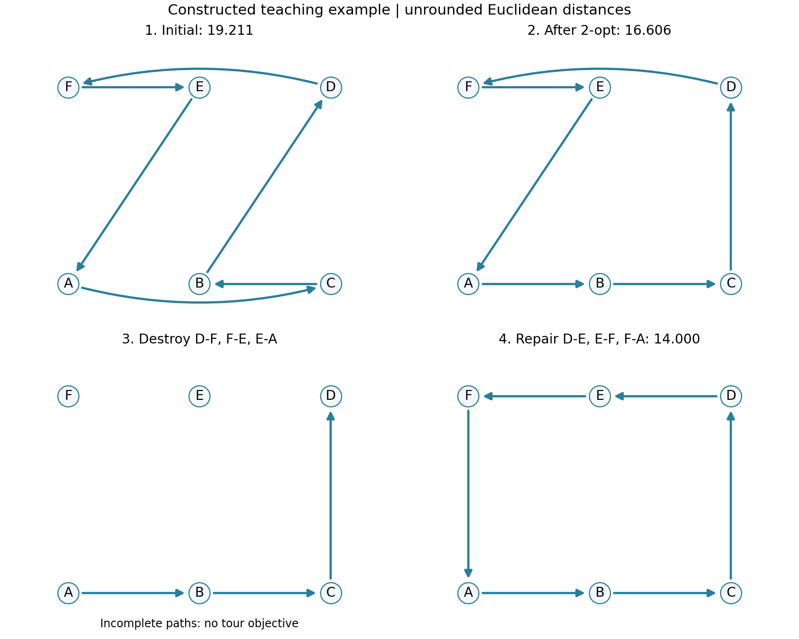
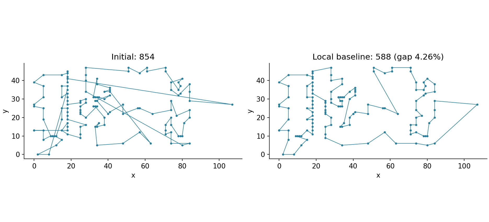
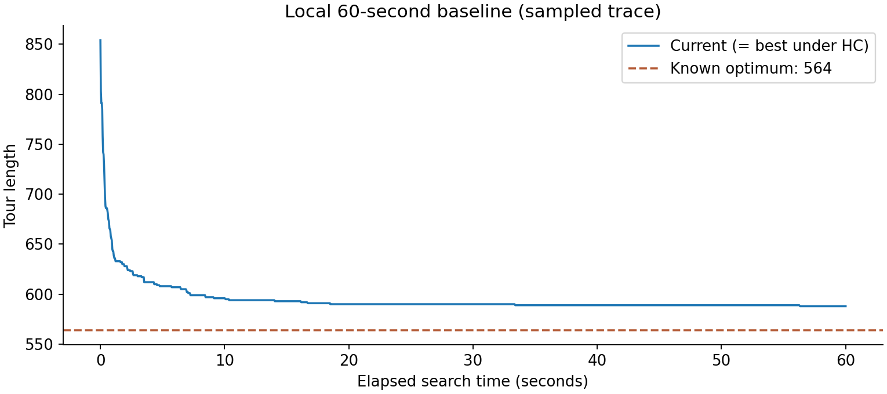
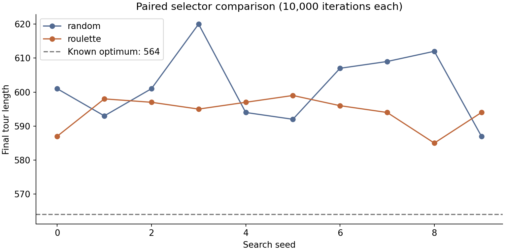
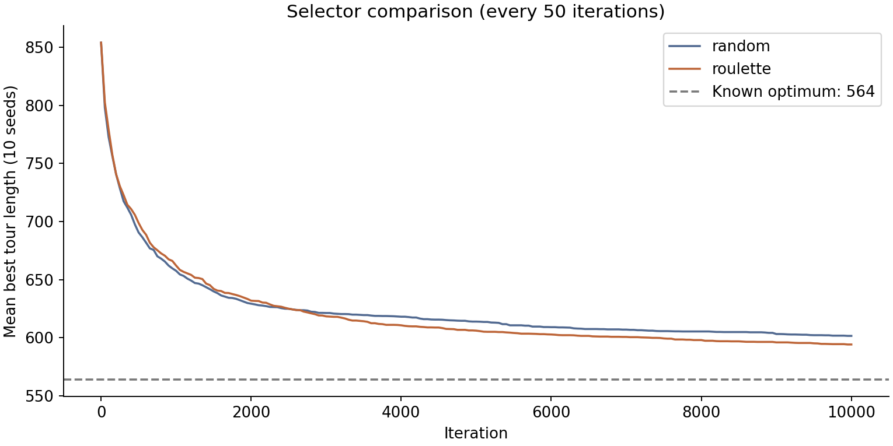

<script setup>
import tspScriptUrl from './alns_tsp.py?url'
import teachingScriptUrl from './make_teaching_figure.py?url'
import teachingDataUrl from './results/teaching-example.json?url'
import sourcesUrl from './results/sources.json?url'
import licenseUrl from './LICENSE-ALNS.txt?url'
import requirementsUrl from './requirements.txt?url'
import environmentUrl from './results/environment.json?url'
import validationUrl from './results/validation.json?url'
import baselineUrl from './results/baseline.json?url'
import comparisonCsvUrl from './results/comparison.csv?url'
import comparisonJsonUrl from './results/comparison.json?url'
import summaryUrl from './results/summary.json?url'
</script>

# 从邻域搜索到 ALNS：原理与 Python 实践

给定一条旅行商路线，怎样才能缩短它？最直接的办法是交换两个城市的访问位置，或者调整一段路线的访问顺序。但如果这些局部调整都无法进一步缩短路线，还能怎样继续搜索？

**大邻域搜索（Large Neighborhood Search，LNS）** 允许我们先拆掉路线的一部分，再重新拼接；**自适应大邻域搜索（Adaptive Large Neighborhood Search，ALNS）** 进一步根据搜索过程中各算子的表现，动态调整不同破坏算子和修复算子的选择概率。

本文先通过一个包含 6 个城市的旅行商问题（TSP）示例，逐步介绍 ALNS 中的破坏、修复、候选解接受和算子权重更新，解释各步骤的作用；随后使用 Python 的 `alns` 库（版本 7.0.0），求解包含 131 个节点的 XQF131 测试实例，展示代码实现与实验结果。理论部分主要参考 Pisinger 与 Røpke 于 2010 年撰写的 [《Large Neighborhood Search》章节](https://orbit.dtu.dk/en/publications/large-neighborhood-search-2/)，实践代码改编自 [ALNS v7.0.0 的官方 TSP 示例 Notebook](https://github.com/N-Wouda/ALNS/blob/v7.0.0/examples/travelling_salesman_problem.ipynb)。

## 1. 从一条路线理解邻域搜索

### 1.1 贯穿全文的 6 城市例子

旅行商问题（TSP）要求从一个城市出发，每个城市恰好访问一次，最后回到起点，并使路线总长度尽量短。本文的小例子有以下坐标：

| 城市 | A | B | C | D | E | F |
| --- | --- | --- | --- | --- | --- | --- |
| 坐标 | $(0,0)$ | $(2,0)$ | $(4,0)$ | $(4,3)$ | $(2,3)$ | $(0,3)$ |

这里使用普通欧氏距离，即两点之间的直线距离，**不取整**。例如 $d(B,D)=\sqrt{(4-2)^2+(3-0)^2}=\sqrt{13}$。后面的 XQF131 使用规定的整数距离，两种计算方式会明确区分。

把一条完整路线记作 $s$，总长度记作 $f(s)$。考虑这条初始路线：

```text
s₀：A → C → B → D → F → E → A
```

它的长度是：

$$
f(s_0)=4+2+\sqrt{13}+4+2+\sqrt{13}
      =12+2\sqrt{13}\approx19.211.
$$

路线的起点只是书写约定。对于这个对称 TSP，绕同一个环从别的城市开始，或沿反方向走，总长度都不变。

### 1.2 邻域的基本概念

**邻域** $N(s)$ 是指按照某种预先定义的操作规则，从当前解 $s$ 出发能够得到的所有候选解构成的集合。不同的操作规则对应不同的邻域。例如，在 TSP 中，可以通过交换两个城市的访问位置来生成新解，也可以通过 2-opt 操作改变路线的连接方式。

以 **2-opt 操作**为例，其基本思想是从当前路线中删除两条边，再通过重新连接形成一条新的完整回路。对于上图中的路线，删除边 $A-C$ 和 $B-D$，加入边 $A-B$ 和 $C-D$，同时将原来从 $C$ 到 $B$ 的子路径反向，即可得到一条新的可行路线。

```text
原路线：A → C → B → D → F → E → A
新路线：A → B → C → D → F → E → A
```

新路线记作 $s_1$，长度为 $13+\sqrt{13}\approx16.606$。内部边 $B-C$ 的长度没有改变，改善来自被替换的两条边：

$$
\Delta=(d(A,B)+d(C,D))-(d(A,C)+d(B,D))
      =5-(4+\sqrt{13})\approx-2.606.
$$

这里 $\Delta$ 表示“新长度减旧长度”，所以负数意味着改进。**2-opt 中的“2”指替换两条边，不表示近似比为 2，也不承诺得到最优解。**

### 1.3 为什么小改动会遇到瓶颈？

如果对规定的邻域 $N(s)$，所有邻居都不比 $s$ 更好，即

$$
f(s)\leq f(s'),\qquad \forall s'\in N(s),
$$

那么 $s$ 是**相对于这个邻域的局部最优解**。这不表示它优于所有可行路线：也许需要同时调整更多边，才能得到更好的路线。

扩大邻域能够探索更多候选解，有助于跳出传统局部搜索的局部最优，但也会显著增加搜索空间。如果逐一枚举邻域中的所有候选解，计算成本往往难以接受。

**大邻域搜索（Large Neighborhood Search，LNS）** 采用了一种更灵活的策略：保留当前解的部分结构，移除其余部分，再通过修复操作重新构造完整解。这样既能对当前解进行较大幅度的调整，又不必显式枚举整个邻域，而是利用启发式方法从中寻找有潜力的候选解。


## 2. 大邻域搜索（LNS）的基本原理

### 2.1 一次完整的破坏与修复

从 $s_1=A\to B\to C\to D\to F\to E\to A$ 出发，删除三条边：

```text
删除：D → F，F → E，E → A
保留：A → B → C → D；E；F
```

这个中间状态已经不是可行的 TSP 路线：它还没有形成覆盖所有城市的回路。破坏阶段暂时允许不完整，是为了释放部分决策，让修复过程重新选择。

现在依次处理还没有出边的城市 $D,E,F$，每次找一条尽可能短、又不会破坏可行性的连接：

| 步骤 | 新增边 | 为什么可以这样连？ |
| --- | --- | --- |
| 1 | $D\to E$，长度 2 | E 没有入边；连接后形成路径 $A\to B\to C\to D\to E$ |
| 2 | $E\to F$，长度 2 | F 没有入边；连接后所有城市都在同一条路径上 |
| 3 | $F\to A$，长度 3 | 此时闭环恰好覆盖全部 6 个城市 |

得到候选路线：

```text
s₂：A → B → C → D → E → F → A
```

其长度 $f(s_2)=2+2+3+2+2+3=14$。候选解比当前解 $s_1$ 更短，采用通常的改进接受规则时，就可以把它作为新的当前解。



*图 1：由上述教学坐标和明确指定的操作生成。弯曲箭头仅为避让标记，距离仍按两端直线计算；各完整路线使用未取整欧氏距离，中间的破坏状态没有完整路线目标值。可查看<a :href="teachingScriptUrl" download="make_teaching_figure.py">绘图脚本</a>和<a :href="teachingDataUrl" download="teaching-example.json">数值记录</a>。*

### 2.2 为什么“最近”还不够？

第一步如果连接 $D\to A$，会形成 $A\to B\to C\to D\to A$。每个已连接城市看起来都能进能出，但 E、F 被留在外面。这就是**提前形成子回路**。

修复必须同时考虑三个条件：当前城市缺少出边、目标城市缺少入边、连接后不能提前闭合一个小环。只有覆盖全部城市时，才允许闭环。后面的 Python 函数 `would_form_subcycle()` 就负责最后一个条件。

贪心修复也不保证选出最好的补法。它的价值是尽快得到可行候选解，让我们有预算尝试更多次破坏和修复。上例指定了处理顺序，程序中会打乱这个顺序，使相同的残缺路线也有机会产生不同结果。

### 2.3 破坏程度如何影响搜索？

删除的边少，修复快，保留的信息多，但变化可能不足；删除的边多，可调整的空间更大，修复成本也更高，还可能反复丢掉已经找到的好结构。

因此，“大邻域”不等于每次重建整条路线，也不等于枚举这个邻域里的所有解。**破坏决定哪些决策暂时失效，修复决定怎样重新做这些决策。** 这个分工是 LNS 的核心。[Shaw，1998](https://doi.org/10.1007/3-540-49481-2_30)、[Pisinger 与 Røpke，2010，§2](https://orbit.dtu.dk/en/publications/large-neighborhood-search-2/)

## 3. ALNS：让有效的算子获得更多机会

### 3.1 为什么准备多种拆法？

对一条路线，可以采用不同的破坏算子：

| 算子 | 做法 | 希望创造什么机会？ |
| --- | --- | --- |
| 随机移除 | 随机删掉若干条不同的边 | 探索分散在路线各处的改动 |
| 路径移除 | 从随机起点删掉一段连续的边 | 集中重建一段路线 |
| 最差移除 | 删除当前最长的若干条边 | 优先重考虑代价大的连接 |

没有一种拆法会在每条路线、每个搜索阶段都占优。ALNS 根据近期表现分配使用机会，同时仍保留探索其他算子的可能性。修复也可以有多个算子；本文的代码为了便于理解，只使用一个贪心修复算子。

### 3.2 权重变成选择概率

为每个破坏算子维护一个正权重 $w_i$。若有 $m$ 个算子，轮盘赌选择概率为

$$
p_i=\frac{w_i}{\sum_{j=1}^{m}w_j}.
$$

其中 $p_i$ 是下次选中算子 $i$ 的概率；权重只决定相对机会，不是确定性的排名。修复算子使用另一组权重，按相同方法选择。本文允许所有破坏和修复组合，不涉及算子配对限制。

### 3.3 候选解的表现怎样变成奖励？

先区分三个解：当前解 $s$ 是本轮操作的出发点，候选解 $s'$ 是本轮新造出的路线，历史最优解 $s^\star$ 是整个搜索至今找到的最好路线。

本文跟随 Python 库的四种互斥结果分类，使用官方 TSP 示例的奖励：

| 结果 | 判断含义 | 奖励 $\sigma$ |
| --- | --- | --- |
| `BEST` | 候选解严格改善历史最优 | 3 |
| `BETTER` | 候选解被接受，严格改善当前解，但未改善历史最优 | 2 |
| `ACCEPT` | 候选解被接受，且不属于上面两类 | 1 |
| `REJECT` | 候选解被拒绝 | 0.5 |

优先判断历史最优，避免同一个候选解重复领取多档奖励。`[3, 2, 1, 0.5]` 对应的是**这四类结果**，不是三个破坏算子的初始权重。

本轮选中的破坏算子和修复算子都用同一奖励更新权重：

$$
w_i\leftarrow\theta w_i+(1-\theta)\sigma.
$$

这里 $\theta\in[0,1]$ 是旧权重的保留比例，$\sigma$ 是本轮奖励。本文取 $\theta=0.8$，相当于保留 80% 的旧值，加入 20% 的本轮表现；没有选中的算子不更新。权重是平滑后的表现估计，不是奖励的无限累加。这个逐次更新形式见 2010 年章节和库的 `RouletteWheel`。[2010 章节，§2.1](https://orbit.dtu.dk/en/publications/large-neighborhood-search-2/)、[v7.0.0 实现](https://github.com/N-Wouda/ALNS/blob/v7.0.0/alns/select/RouletteWheel.py)

为什么两个算子都拿到同一奖励？候选解是它们协作的产物，单次结果很难分离各自贡献。这是简单实用的反馈规则，并不是精确的因果评估。

### 3.4 手算一次更新

按照“随机、路径、最差”的顺序，设初始破坏权重为 $(1,1,1)$，各自被选中的概率都是 $1/3$。

假设本轮用路径移除完成了上一节的操作，从长度约 16.606 的路线得到长度 14，且刷新了历史最优。奖励为 3，于是路径移除的权重变成

$$
w_{\mathrm{path}}=0.8\times1+0.2\times3=1.4.
$$

更新后的权重为 $(1,1.4,1)$，下轮概率为

$$
(p_{\mathrm{random}},p_{\mathrm{path}},p_{\mathrm{worst}})
=\left(\frac1{3.4},\frac{1.4}{3.4},\frac1{3.4}\right)
\approx(29.41\%,41.18\%,29.41\%).
$$

路径移除的机会增加了，另外两种仍可能被选中。唯一的修复算子也从 1 更新为 1.4，但因为只有它一个，选择概率仍是 100%。

假设接下来选中随机移除，候选解被拒绝，那么随机移除的权重变为 $0.8\times1+0.2\times0.5=0.9$。拒绝的正奖励是本例的参数选择，能避免该算子仅因连续失败就逐次衰减到接近零；它不是 ALNS 必须采用的常数。

::: info 经典机制与本篇实现的边界
2006 年的经典 ALNS 论文在一个搜索段内累积奖励，并在段末按算子的平均奖励更新权重。对使用过的算子，可写成 $w_i\leftarrow(1-r)w_i+rS_i/n_i$；其中 $S_i$ 是段内总分，$n_i>0$ 是使用次数，$r$ 是反应系数，还涉及对已访问解的处理。本文只展开逐次更新。

库的 `SegmentedRouletteWheel` 又有自己的实现选择：段末使用累计分数，不除以使用次数。不要因为名字里都有“分段”，就把这些公式当作同一个实现。[Røpke 与 Pisinger，2006](https://pubsonline.informs.org/doi/10.1287/trsc.1050.0135)、[v7.0.0 分段选择器源码](https://github.com/N-Wouda/ALNS/blob/v7.0.0/alns/select/SegmentedRouletteWheel.py)
:::

## 4. 接受准则：当前解可以变差，历史最好记录不能丢

### 4.1 先理解爬山接受

最容易理解的规则是：候选解不比当前解差就接受，否则拒绝。在 `alns==7.0.0` 中，`HillClimbing` 的判断是

$$
f(s')\leq f(s).
$$

注意这里包含等号，等值路线也能被接受。严格改进的爬山规则则会用 $<$；讨论算法时要说明采用哪种约定。[v7.0.0 HillClimbing 源码](https://github.com/N-Wouda/ALNS/blob/v7.0.0/alns/accept/HillClimbing.py)

这条规则简单，但无法通过暂时变差来离开当前区域。它也不要求新路线改变很多：一次 LNS 操作可能改善、持平，也可能变差，接受准则负责最后的判断。

### 4.2 当前解与历史最优解为什么分开保存？

当前解回答“下一轮从哪里出发”，历史最优解回答“到现在为止，找到的最好结果是什么”。接受准则可以允许暂时变差，以便继续探索；但这不应该覆盖已经找到的最好记录。[2010 章节，算法 2 与 §2.2](https://orbit.dtu.dk/en/publications/large-neighborhood-search-2/)

继续使用这 6 个城市：当前解和历史最优解都为长度 14 的 $s_2$，新候选解回到了长度约 16.606 的 $s_1$。Hill Climbing 会拒绝它。如果换成一个允许这次变差的接受准则，接受之后就应当这样记录：

| 记录 | 接受前 | 接受后 | 原因 |
| --- | --- | --- | --- |
| 当前解 | $s_2$，长度 14 | $s_1$，长度约 16.606 | 下一轮从新接受的路线出发 |
| 历史最优解 | $s_2$，长度 14 | 仍为 $s_2$，长度 14 | 新路线没有刷新最好记录 |

搜索结束时返回历史最优解，就不会因为最后几步探索而丢掉更好的结果。接受策略是可以替换的组件，具体怎样接受较差候选留到延伸阅读。

本次实测统一采用 Hill Climbing。在这组爬山实验中，当前目标值始终等于历史最优目标值，所以四档奖励中的 `BETTER` 不会出现：严格改善当前解也就是刷新历史最优；等值接受属于 `ACCEPT`。

## 5. 把一轮搜索连接起来

下面的伪代码采用本文的逐次权重更新。`copy` 表示保护原有状态的独立副本，停止条件可以是迭代次数或运行时间。`accept` 可以维护所选接受策略需要的内部状态。

```text
输入：初始可行解 s0；破坏算子集合 D；修复算子集合 R
      奖励 scores；旧权重保留比例 θ；接受准则 accept
      停止条件 stop；随机数生成器 rng

current ← copy(s0)
best ← copy(s0)
破坏权重 wD、修复权重 wR ← 全部为 1
初始化接受准则、停止条件和统计记录

while stop 尚未满足：
    按归一化 wD 选择破坏算子 d
    按归一化 wR 选择修复算子 r
    partial ← d(copy(current), rng)
    candidate ← r(partial, rng)      # 完成后须为可行路线

    old_cost ← f(current)
    accepted ← accept(rng, best, current, candidate)

    if f(candidate) < f(best)：
        outcome ← BEST
        best ← copy(candidate)
        current ← candidate
    else if accepted：
        outcome ← BETTER if f(candidate) < old_cost else ACCEPT
        current ← candidate
    else：
        outcome ← REJECT

    reward ← scores[outcome]
    wD[d] ← θ × wD[d] + (1 − θ) × reward
    wR[r] ← θ × wR[r] + (1 − θ) × reward
    记录当前解、历史最优解和算子表现

返回 best 及统计记录
```

这段伪代码综合了 2010 年章节的逐次更新形式，以及库 v7.0.0 的结果分类和新历史最优处理顺序。它不是 2006 年分段算法的逐行翻译。[2010 章节](https://orbit.dtu.dk/en/publications/large-neighborhood-search-2/)、[v7.0.0 主循环](https://github.com/N-Wouda/ALNS/blob/v7.0.0/alns/ALNS.py)

尤其要注意：**Python 库把当前解直接交给破坏算子，复制由我们负责。** 如果在原对象上删边，即使稍后拒绝候选解，当前解也已被改坏；当前解与历史最优还可能共享同一个对象，连最好记录都会受到影响。

## 6. Python 实践：从小例子走向 XQF131

### 6.1 资料、数据与运行入口

本节使用官方 TSP 示例的 131 城市实例 XQF131。原站给出的最优路线长度为 **564**。数据由 André Rohe 提供，基于 Bonn 的 VLSI 数据；原始说明和最优路线入口见 [Waterloo TSP 数据页](https://www.math.uwaterloo.ca/tsp/vlsi/index.html)。本次读取 ALNS v7.0.0 仓库的配套数据副本，代码依据同一版本的 [官方 Notebook](https://github.com/N-Wouda/ALNS/blob/v7.0.0/examples/travelling_salesman_problem.ipynb)，下载地址与文件摘要记录在 <a :href="sourcesUrl" download="sources.json">sources.json</a>。

本地已有的资料保留在项目根目录 `_private/ALNS/`，其中 `Pisinger.pdf` 是 2010 年第二版手册章节的 DTU 公开稿。文档简介引用的同名 2019 年章节是另一版本，本文没有把二者混用。网页转存 PDF 中有广告遮挡和公式错位，代码以固定版本 Notebook 为准。

随文脚本 <a :href="tspScriptUrl" download="alns_tsp.py">alns_tsp.py</a> 包含数据读取、算子、验证、实验和绘图。正文中的 Python 片段直接从它导入，避免出现“文章一份、实际运行另一份”的漂移。脚本是对官方示例的改编，保留了来源说明和上游 <a :href="licenseUrl" download="LICENSE-ALNS.txt">MIT 许可证</a>。

本项目的资料位置如下，已有文件直接复用：

```text
_private/ALNS/
├── …原有四份 PDF
├── .venv/                         # 本次独立 Python 环境
└── upstream-v7.0.0/
    ├── travelling_salesman_problem.ipynb
    └── data/
        ├── xqf131.tsp
        └── xqf131.opt.tour
```

原站的最优路线文件名为 `xqf131.tour`，本地使用 Notebook 所需的 `xqf131.opt.tour`。随文脚本也兼容原文件名。独立复现时，把数据放在上述位置，或用 `--data-dir` 指定自己的数据目录。

本次记录环境为 Windows x64、Python **3.9.10**，主要依赖如下；完整版本见 <a :href="requirementsUrl" download="requirements.txt">requirements.txt</a>，机器和输入文件摘要见 <a :href="environmentUrl" download="environment.json">environment.json</a>。这是本次运行记录，不代表其他环境一定产生相同轨迹。

| 依赖 | 版本 | 本例用途 |
| --- | --- | --- |
| `alns` | 7.0.0 | 搜索框架、选择器和接受准则 |
| `numpy` | 1.26.4 | 随机数、距离矩阵与统计 |
| `tsplib95` | 0.7.1 | 数据读取及距离规则 |
| `networkx` | 2.8.8 | `tsplib95` 依赖及官方 Notebook 图结构 |
| `matplotlib` | 3.9.4 | 绘图 |

以下为从项目根目录运行的 PowerShell 命令，其中 `python` 指向要用于复现的 Python 安装。首次复现时创建隔离环境并安装本次依赖；已有本轮环境时直接执行后面的脚本命令：

```powershell
python -m venv _private/ALNS/.venv
& _private/ALNS/.venv/Scripts/python.exe -m pip install -r docs/optimization/alns/requirements.txt

& _private/ALNS/.venv/Scripts/python.exe docs/optimization/alns/alns_tsp.py validate
& _private/ALNS/.venv/Scripts/python.exe docs/optimization/alns/alns_tsp.py baseline
& _private/ALNS/.venv/Scripts/python.exe docs/optimization/alns/alns_tsp.py compare
```

`baseline` 默认运行 60 秒，`compare` 默认执行下文的 20 次搜索。实验完成后，`report` 命令可以仅根据保存的 JSON 重新绘图。代码片段依赖脚本中的导入和数据读取辅助函数；直接运行完整脚本即可，无须逐段复制拼接。

### 6.2 距离规则先对齐

XQF131 使用 `EUC_2D`，每条边的长度是**先计算欧氏距离，再取最近整数**：

$$
d(i,j)=\left\lfloor\sqrt{(x_i-x_j)^2+(y_i-y_j)^2}+0.5\right\rfloor.
$$

这里 $(x_i,y_i)$ 是城市 $i$ 的坐标，$\lfloor\cdot\rfloor$ 表示向下取整。要逐条边取整后再求和，不能对整条路线的浮点长度最后只取整一次；也不要无条件换成采用不同半整数规则的 `round()`。脚本使用实例提供的权重规则，并核对公开最优路线的计算结果为 564。[TSPLIB 官方资料入口](https://comopt.ifi.uni-heidelberg.de/software/TSPLIB95/)、[官方 TSP 示例](https://alns.readthedocs.io/en/latest/examples/travelling_salesman_problem.html)

### 6.3 用后继映射表示一条路线

小例子的最终路线可以写成：

```python
edges = {"A": "B", "B": "C", "C": "D", "D": "E", "E": "F", "F": "A"}
```

`edges[u] = v` 表示从城市 `u` 直接前往城市 `v`。删除一条边就是删除一个字典项；修复就是添加缺少的映射。这种表示让破坏和修复很直接，也说明为什么**字典里有 n 条边并不足以证明路线可行**：它可能是多个互不相连的小环。

<<< ./alns_tsp.py#state{python}

`objective()` 负责返回完整路线的总长度。破坏后的状态缺边，不能把它当作完整解比较目标值；必须先修复。状态副本只复制会变化的边映射，坐标和距离等只读实例数据可以共享。

### 6.4 三种破坏算子如何对应原理？

<<< ./alns_tsp.py#destroy{python}

先复制状态，再删边，是三种算子共有的第一步。`random_removal` 不放回地抽样，保证实际删除指定数量的不同边；`path_removal` 沿当前后继关系连续删除；`worst_removal` 按边长排序，优先移除最长边。

官方配置的破坏比例为 0.1，因此在 131 条边的完整回路中，每次删除 $\lfloor131\times0.1\rfloor=13$ 条边。本文脚本还为小实例设置至少删除一条边的下限，避免 6 城市乘 10% 后得到零；这个保护不改变 XQF131 的破坏数量。

### 6.5 修复：把若干段路径接成一个环

<<< ./alns_tsp.py#repair{python}

可以把这段代码按上一节的 $D\to E\to F\to A$ 操作来读：先找缺少出边的城市，再从缺少入边的城市中筛掉自身和会提前闭环的选择，最后接向其中最近的城市。

`would_form_subcycle()` 沿候选目标的后继向前追踪：如果太早回到出发城市，就会形成子回路，必须排除；如果恰好经过全部城市，则允许最后闭环。随机打乱缺出边城市的处理顺序，会影响贪心选择，因此它也是候选解多样性的来源。

初始解也由这个函数生成：`initial_solution()` 从没有任何边的 `TspState(data, {})` 出发，调用贪心修复拼出完整回路。因此我们不必先提供一条精心设计的路线。本次把这一步的种子固定为 7654，得到长度 854 的可行初始解。

### 6.6 把组件组装起来

搜索入口是 `algorithm.iterate(initial.copy(), selector, accept, stop, degree=DEGREE)`：初始解决定从哪里开始，选择器决定用哪些算子，接受准则决定是否换到候选解，停止条件决定何时结束。下面函数的后半部分用于校验和保存实验记录，初读时可以先关注这四个组件。

<details>
<summary>展开实际运行函数：组件组装、搜索与结果记录</summary>

<<< ./alns_tsp.py#run{python}

</details>

本篇只比较两种选择器：

- **均匀随机 `RandomSelect`**：三个破坏算子各有 $1/3$ 的选择概率，不根据结果更新。
- **自适应轮盘 `RouletteWheel`**：初始权重均为 1，根据 `[3, 2, 1, 0.5]` 和 $\theta=0.8$ 逐次更新。

其余部分保持一致：相同的三个破坏算子、一个贪心修复算子、10% 破坏比例、Hill Climbing 接受准则。初始解使用独立种子 7654 生成；每次运行重新创建算法对象、选择器、接受准则、停止条件和搜索随机数生成器，避免上一轮的权重或内部状态延续到下一轮。

相同种子并不意味着两种选择器随后使用完全相同的随机序列：它们调用随机数的方式和产生的搜索路径可能不同。这里控制的是初始条件与搜索预算，再通过多种子结果观察波动。

### 6.7 本次验证了哪些关键条件？

随文 `validate` 已通过以下检查，记录见 <a :href="validationUrl" download="validation.json">validation.json</a>：

- 距离矩阵的每一项与 TSPLIB 权重一致；公开参考路线可行且长度为 564；种子 7654 生成的初始路线长度为 854。
- 三种破坏算子均保留原状态，XQF131 每次删 13 条边；小实例至少删一条边；破坏后的不完整状态不能直接求完整路线目标值。
- 共 60 个破坏／修复案例恢复为完整单回路，覆盖 XQF131 和不连续编号的四城市实例。
- 提前闭合子回路会被拒绝，覆盖全部城市后的闭环会被允许；独立校验器能识别“入出度正确、实际却有两个环”的错误解。
- 两种选择器分别重复运行同一种子和预算，重建所有组件后得到一致的路线和算子计数。

另用固定 v7.0.0 Notebook 的原始定义、数据和初始解代码做了短程等价检查：种子 7654、100 次迭代下，原版与整理脚本的初始边映射、101 个目标值记录、最终边映射和算子结果计数全部一致，最终长度均为 791。这个检查用于确认改编没有改变该次搜索语义，正式基线仍以下面的 60 秒实测为准。

每次独立搜索结束后，还会检查最终最佳路线可行、初始解未被修改、迭代预算符合要求，以及爬山接受下的目标值没有上升。这些检查验证代码和本次输出的基本正确性，不保证算法找到了最优路线。

### 6.8 官方配置基线：60 秒能得到什么？

基线采用官方配置：初始解种子和搜索种子均为 7654，轮盘奖励 `[3, 2, 1, 0.5]`，旧权重保留比例 0.8，破坏比例 0.1，Hill Climbing，搜索时间上限 60 秒。

官方 TSP 文档页面展示的结果是 **854 → 588，gap 约 4.3%**；下载的 v7.0.0 Notebook 源文件没有保存执行输出。这只是文档页面的运行记录，不是本机结果，也不是固定种子下对所有机器的承诺。时间停止意味着更快的机器可以执行更多迭代。[官方 TSP 文档](https://alns.readthedocs.io/en/latest/examples/travelling_salesman_problem.html)

本文统一使用

$$
\mathrm{gap}(\%)=100\times\frac{f(s^\star)-564}{564}
$$

衡量结果相对已知最优值的差距，其中 $s^\star$ 是本次运行保存的最佳路线。

**本机于 2026-10-15 的正式基线结果如下：**

| 初始长度 | 最终最佳长度 | gap | 完成迭代 | 搜索实测耗时 | 最终路线 |
| --- | --- | --- | --- | --- | --- |
| 854 | **588** | **4.255%** | **51,062** | **60.001 秒** | 可行，覆盖全部 131 个城市的单回路 |

本次结果恰好与文档展示的长度 588 相同，但这不能证明两次运行的迭代数、完整路线或搜索轨迹相同。实测耗时在搜索调用外计量，包含很小的调用开销，停止判断也可能跨过预算边界一个迭代。完整参数、最佳路线和采样轨迹见 <a :href="baselineUrl" download="baseline.json">baseline.json</a>。



*图 2：由本机基线实际保存的路线生成，两幅图使用相同坐标。*



*图 3：本机基线的目标值变化；横轴为搜索耗时，曲线按保存的轨迹抽样绘制。Hill Climbing 下，当前解与历史最佳解的目标值重合。*

### 6.9 对照实验：自适应一定更好吗？

为了把比较重点放在算子选择上，本次对照改用固定迭代预算，每种选择器运行 **10 个搜索种子：0—9**，每次 **10,000 次迭代**。20 次运行都从种子 7654 生成的同一初始路线出发。固定预算便于比较同样次数的候选解构造，但不代表每次运行耗时相同。

本次没有调整接受准则、破坏比例，也没有进行算子消融。报告目标值、gap、均值、样本标准差和实测耗时；均值和标准差都跨 10 个种子计算，标准差使用 $n-1$ 作分母。

下表是全部 20 次运行的实测结果。它们的初始长度都为 854，均完成 10,000 次迭代，最终路线全部通过可行性检查。时间只计 `iterate()` 搜索调用，不包含数据读取、初始解构造和绘图。

| 搜索种子 | 随机：长度 | 随机：gap（%） | 随机：秒 | 轮盘：长度 | 轮盘：gap（%） | 轮盘：秒 |
| --- | --- | --- | --- | --- | --- | --- |
| 0 | 601 | 6.560 | 9.786 | 587 | 4.078 | 12.348 |
| 1 | 593 | 5.142 | 10.377 | 598 | 6.028 | 11.028 |
| 2 | 601 | 6.560 | 11.111 | 597 | 5.851 | 10.977 |
| 3 | 620 | 9.929 | 10.217 | 595 | 5.496 | 11.578 |
| 4 | 594 | 5.319 | 10.341 | 597 | 5.851 | 10.804 |
| 5 | 592 | 4.965 | 9.236 | 599 | 6.206 | 10.521 |
| 6 | 607 | 7.624 | 9.600 | 596 | 5.674 | 12.124 |
| 7 | 609 | 7.979 | 10.645 | 594 | 5.319 | 11.764 |
| 8 | 612 | 8.511 | 9.868 | 585 | 3.723 | 10.626 |
| 9 | 587 | 4.078 | 9.884 | 594 | 5.319 | 10.326 |

汇总如下，表中的“±”是 **10 次运行的样本标准差**，不是均值的置信区间：

| 选择器 | 长度均值 ± 标准差 | 长度范围 | gap 均值 ± 标准差（%） | 耗时均值 ± 标准差（秒） |
| --- | --- | --- | --- | --- |
| 均匀随机 | 601.6 ± 10.373 | 587—620 | 6.667 ± 1.839 | 10.107 ± 0.544 |
| 自适应轮盘 | **594.2 ± 4.638** | 585—599 | **5.355 ± 0.822** | 11.210 ± 0.701 |

在这次对照中，轮盘选择的平均长度低了 **7.4**，种子间波动也更小；按相同种子逐对比较，它有 **6 次更好、4 次更差、0 次持平**。因此，这组结果支持“本次配置下，轮盘平均表现更好”，同时也直接展示了自适应并非每次都获胜。

轮盘的平均搜索耗时稍高。选择策略带来的开销和不同搜索路径中的修复工作都会影响时间，不能把全部差值都归因于权重更新。本次也没有做显著性检验，不能把一个实例上的 10 个种子视为普遍结论。

对照中的最好长度 585 小于 60 秒基线的 588，但它们采用了不同的搜索种子，不能据此推断更少的迭代更有利。未四舍五入的数据见 <a :href="comparisonCsvUrl" download="comparison.csv">comparison.csv</a>，完整运行记录见 <a :href="comparisonJsonUrl" download="comparison.json">comparison.json</a>，汇总见 <a :href="summaryUrl" download="summary.json">summary.json</a>。



*图 4：每个点来自一次实际运行，较低的路线长度更好。*



*图 5：每种选择器的 10 次运行在相同迭代位置的历史最佳目标值均值，每 50 次迭代采样一次。*

这组实验只说明**这个实例、这组算子、这些参数和预算下**的表现。ALNS 的反馈规则会受奖励设计、算子互补性和偶然搜索结果影响；自适应并不构成“必然优于均匀随机”的保证。

## 7. 常见误区与继续阅读

### 7.1 大邻域不等于保证跨过所有局部最优

LNS 只探索修复策略实际能产生的候选解。破坏范围更大不代表候选解一定更好，修复过于固定还可能反复造出同一条路线。ALNS 的目标是提高有限时间内找到好解的机会，并不为一般问题提供全局最优保证。

### 7.2 奖励、权重和目标值不是同一个量

目标值是问题本身的路线长度，越小越好；奖励是人为设置的反馈信号，越高越鼓励该次使用的算子；权重是影响未来选择概率的内部状态。三个量不应混在一起解释。

### 7.3 接受了候选解，不代表它是历史最好

采用允许变差的接受准则时，当前路线可以变长；输出时仍应返回历史最优解。即使只使用 Hill Climbing，保护状态副本也不可省略，因为破坏是在接受判断之前发生的。

### 7.4 131 条边，也可能拼出多个环

最终检查必须沿后继映射走完整条路线，确认每个城市恰好访问一次并返回起点，还要检查每个节点的入度、出度。只检查目标值或边数，可能把不可行解误当作非常短的“好解”。

### 7.5 相同数据名，不一定代表相同实验

距离取整规则、数据版本、算子顺序、随机种子、依赖版本和停止条件都会影响结果。特别是改成普通浮点欧氏距离后，不能继续直接用 564 作为最优值计算 gap。

### 参考资料

1. Pisinger, D., & Røpke, S. **Large Neighborhood Search**. *Handbook of Metaheuristics*, 2nd ed., 2010, pp. 399–420。[DTU 公开稿及书目信息](https://orbit.dtu.dk/en/publications/large-neighborhood-search-2/)。本文邻域、破坏／修复与逐次权重更新的主要理论依据；本地文件为 `Pisinger.pdf`。
2. Shaw, P. **Using Constraint Programming and Local Search Methods to Solve Vehicle Routing Problems**. CP 1998, pp. 417–431。[原始出版页](https://doi.org/10.1007/3-540-49481-2_30)。LNS 的早期经典来源。
3. Røpke, S., & Pisinger, D. **An Adaptive Large Neighborhood Search Heuristic for the Pickup and Delivery Problem with Time Windows**. *Transportation Science*, 40(4), 2006, pp. 455–472。[出版页](https://pubsonline.informs.org/doi/10.1287/trsc.1050.0135)、[DTU 作者稿入口](https://orbit.dtu.dk/en/publications/an-adaptive-large-neighborhood-search-heuristic-for-the-pickup-an/)。用于区分原始分段机制。
4. Wouda, N. A., & Lan, L. **ALNS: a Python implementation of the adaptive large neighbourhood search metaheuristic**. *Journal of Open Source Software*, 8(81), 5028, 2023。[开放论文](https://joss.theoj.org/papers/10.21105/joss.05028)。Python 库的软件论文；本文实现固定为 v7.0.0。
5. ALNS 项目贡献者。**A brief introduction to ALNS**、**ALNS features**、**The travelling salesman problem**，7.0.0 文档。[原理简介](https://alns.readthedocs.io/en/latest/setup/introduction_to_alns.html)、[功能教程](https://alns.readthedocs.io/en/latest/examples/alns_features.html)、[TSP 教程](https://alns.readthedocs.io/en/latest/examples/travelling_salesman_problem.html)、[固定版本源码](https://github.com/N-Wouda/ALNS/tree/v7.0.0)。网页可能更新，重现实验以固定版本 Notebook 和随文依赖记录为准。
6. University of Waterloo。**VLSI Data Sets**。[数据说明](https://www.math.uwaterloo.ca/tsp/vlsi/index.html)、[XQF131 实例](https://www.math.uwaterloo.ca/tsp/vlsi/xqf131.tsp)、[最优路线](https://www.math.uwaterloo.ca/tsp/vlsi/xqf131.tour)。


